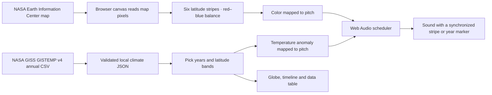

# EARTHSONA

**Hear the Earth. Understand its changes.**

EARTHSONA is an interactive Earth Information Jukebox built for NASA Space Apps Challenge 2026. Use it to hear the colors of NASA Earth Information Center maps and compare surface-temperature changes across latitude bands on one pitch scale.

[Open on Vercel](https://earthsona.vercel.app/) · [GitHub Pages](https://unknowngod2011.github.io/EARTHSONA/) · [Watch the demo](https://unknowngod2011.github.io/EARTHSONA/demo/) · [Official challenge](https://www.spaceappschallenge.org/2026/challenges/the-earth-information-jukebox/)

## Listen and explore

- **Tour with Luma** opens a narrated tour of the real observatory, from the NASA frame and sonification controls to the climate chart, findings, and sources. Visitors can mute the voice, skip the tour, or go back at any stage. The crystal runs in beside the title, looks toward the pointer, wanders, naps, peeks around the screen edge, and walks when dragged.
- **Listen with Luma** guides a first-time visitor through an official NASA map scan and a controlled four-note comparison. The same instrument plays Arctic and global ten-year mean anomalies before the guide reveals the values and their source. [Website narration script and asset instructions](docs/LUMA_VOICE_LINES.md)
- **NASA frames** turns six north-to-south stripes of each official 2023, 2024, and 2025 NASA map into tones. Select **Frame colors** for the rendered map or **GISTEMP annual reading** for that year’s global numeric value.
- **Climate globe** shows annual temperature anomalies from 1880–2025 across eight latitude bands on a rotating Blue Marble sphere, with a NASA star map backdrop. Compare two tracks, change the playback range and speed, use the chart or year slider to inspect exact values, and open the data table for a text view.
- **Discoveries** opens comparisons calculated from the shipped NASA source table. In 2016, the Arctic band was +3.23°C above its baseline and the Antarctic band was +0.35°C. The app maps that 2.88°C gap to an audible interval.

For the numeric tracks, 0°C anomaly plays at 220 Hz and every +2°C adds an octave. Both tracks use the same scale and a 1951–1980 reference period. The frame scan uses a separate color-to-pitch mapping, and its output depends on the source palette and projection. Compare temperatures across years with the numeric tracks. The globe displays regional averages rather than station readings, fine-grained rasters, or local forecasts.

## Run locally

Requires Node.js 22.12+ and npm. Once built, the app runs without an API, account, or key. Playback uses browser Web Audio and starts on a user action.

```sh
npm ci
npm run dev
npm run data:check
npm test
npx playwright install chromium
npm run test:browser
npm run build
```

Vite produces `dist/` for static hosting. The Vercel project is linked to this GitHub repository, and GitHub Actions validates the data, runs the unit and browser suites, and deploys `main` to GitHub Pages. To rebuild the browser JSON from the pinned CSV, run `node scripts/build-climate.mjs`. The [data guide](docs/DATASET_RESEARCH.md) explains how to refresh the upstream download and preserve its checksum and provenance.

## Architecture



The map scan plays the visual palette. The climate tracks play the measured anomalies on a shared scale. Both run in the browser from bundled NASA assets. [Architecture and deployment](docs/ARCHITECTURE.md) · [Sonification methodology](docs/SONIFICATION_METHODOLOGY.md)

## Data and design

- [Scientific data and attribution](docs/DATASET_RESEARCH.md) · [Findings and calculations](docs/DISCOVERED_INSIGHTS.md)
- [Challenge analysis](docs/CHALLENGE_ANALYSIS.md) · [Product direction](docs/PRODUCT_DIRECTION.md) · [Open-source research](docs/OPEN_SOURCE_RESEARCH.md)
- [Testing](docs/TESTING.md) · [Self-evaluation](docs/SELF_EVALUATION.md) · [Screenshots](screenshots/)
- [Demo script](docs/DEMO_SCRIPT.md) · [Submission checklist and form copy](docs/SUBMISSION_CHECKLIST.md)

The numeric data comes from [NASA GISS GISTEMP v4](https://data.giss.nasa.gov/gistemp/). The maps come from [NASA’s Scientific Visualization Studio](https://svs.gsfc.nasa.gov/gallery/earth-information-center/), with data provided by Robert B. Schmunk (NASA/GSFC GISS). The basemap uses [NASA Earth Observatory Blue Marble Next Generation](https://science.nasa.gov/earth/earth-observatory/blue-marble-next-generation/). Source-specific terms and credits apply to NASA material. The font distribution includes the three SIL OFL notices in [`public/fonts`](public/fonts/). Original project code and documentation are under [Apache 2.0](LICENSE).

The team defined the project concept and used OpenAI Codex for research, code, tests, documentation, and demo assembly. Luma uses the team’s existing AI-assisted keyboard.wtf sprite. The website credits the artwork and generated narration in Method & Sources. The original EARTHSONA mark takes visual inspiration from React Bits’ Crystalized Ball and Orb. Browser sonification is deterministic synthesis from NASA values or map pixels. See [submission disclosures](docs/SUBMISSION_CHECKLIST.md).
