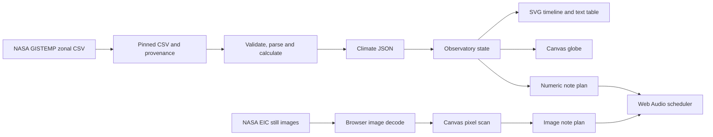

# Architecture

EARTHSONA is a static Vite application. The browser handles interaction, visualization, frame sampling, and synthesis. Every runtime asset is served with the app. The source snapshot and its verification script make the shipped comparison reproducible without network access to NASA during a session.

## Source pipeline and runtime

`scripts/build-climate.mjs` verifies the official table schema, checks years and values, pins provenance with SHA-256, and generates `src/data/climate.json`. The checked-in CSV also serves as the download in the product. The script recomputes the featured comparisons and verifies each EIC image checksum with `--check`. `src/data/eic.json` identifies each archived map, its source, native dimensions and attribution. Read [Dataset research](DATASET_RESEARCH.md) for source coverage and [Discovered insights](DISCOVERED_INSIGHTS.md) for calculations.

`src/main.js` holds the current year, range, selected series, playback, and view state. `src/layout.js` defines the controls and public-facing explanations. The chart uses SVG paths with missing-value gaps, and the table reads the same observation objects. Switching tracks or modes stops playback before rebuilding the selection. The audio module uses the AudioContext clock with a look-ahead queue and cancels scheduled nodes when playback stops. Cursor and stripe updates track the same score clock. See [Sonification methodology](SONIFICATION_METHODOLOGY.md).

## Globe and frame assets

`src/globe.js` projects a unit sphere orthographically and resolves each visible pixel into latitude and longitude. The NASA Blue Marble Next Generation equirectangular image is sampled using `u = (longitude + 180)/360`, `v = (90 − latitude)/180`. Latitude-band masks use documented GISTEMP latitude boundaries rather than texture pixels. The sphere is a geographic display approximation and conveys neither elevation nor precise distances. The diverging globe color scale saturates at ±3°C. Tooltips, charts, and tables retain the full anomaly. Stills in NASA frames use their original Robinson projection, processing and embedded legends. The frame scan uses approximate latitude stripes and does not reproject the image. [Basemap processing and credit](../public/earth/README.md)

The globe coalesces redraws with `requestAnimationFrame`, caps render resolution, and uses Canvas 2D so a dedicated GPU and WebGL are optional. Band coloring remains available if the basemap image fails. The frame scan caches the derived stripe plan for the selected image until the frame changes. Mobile users can rotate horizontally, pinch to zoom, and scroll vertically. Keyboard rotation, select menus, and the data table provide alternative paths.

The globe exposes its viewing angles to pan the NASA Deep Star Maps 2020 backdrop. The view pans the original star catalog visualization for atmosphere. The sky stays fixed when reduced motion is enabled. [NASA star map](https://svs.gsfc.nasa.gov/4851/) · [Asset provenance and limits](../public/earth/README.md)

## Guided listen and motion

The Luma guide is a native dialog with three steps and focus return. It uses the shipped NASA image and the same scanner and audio engine as the main explorer. It calculates the equal-window comparison from the annual observations in the browser. The four notes use the same waveform and volume so that the pitch interval is the comparison cue. The text reveal keeps the result accessible without listening. The existing keyboard.wtf Luma artwork is bundled as four cropped sprite strips. Optional read-aloud uses a local browser voice and yields to scientific audio. No microphone or API credentials are needed.

The theme choice is stored locally. Light mode is the default. The title particles run on the first visit in the browser, then leave the original text in the page. Reduced motion skips the reveal and disables the optional decorative motion. The crystal-orb mark is original SVG with a focus or hover animation.

## Deployment and maintenance

Install from the npm lockfile with `npm ci`. `npm run build` writes a relative-base static bundle. `.github/workflows/pages.yml` validates the bundled snapshots and exercises Chromium before publishing `main`. No server secrets, trackers, third-party runtime calls, database or service worker are required. The host serves normal HTTP cache headers and Vite fingerprints its bundled JS and CSS. After a snapshot refresh, review changed insights and the README’s stated end year before deploying.
